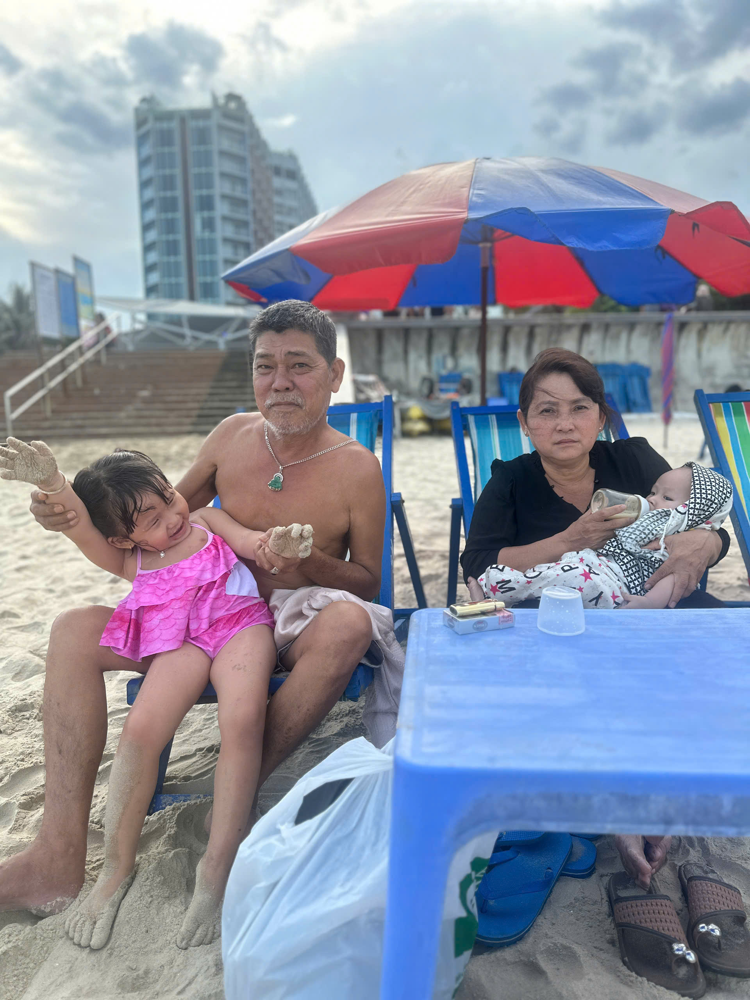

# Ảnh — 2026-11-20T19-10-40-992Z-z7972405143310-373b4c3b31abc9e6aeeb18eb26127c94

Ngày phân tích: 2026-11-20T19:10:40.992Z

## Phân tích

**Mô tả:**  
Bức ảnh chụp khoảnh khắc gia đình gồm ông bà (hoặc cha mẹ lớn tuổi) đang ngồi thư giãn dưới lọng dù trên bãi biển cùng hai cháu/con nhỏ (một bé gái mặc đồ bơi hồng và một em bé đang được cho bú bình). Bối cảnh đời sống là kỳ nghỉ dưỡng, du lịch gia đình bên bờ biển.

**Text trích xuất:**  
Không có văn bản, hóa đơn hay số liệu quan trọng nào xuất hiện rõ nét trong ảnh.

**Thẻ gợi ý:**  
`#gia_dinh`, `#du_lich`, `#nghi_duong`, `#bai_bien`, `#ky_niem`

**Liên kết gợi ý:**  
`[[Kỷ niệm gia đình]]`, `[[Nhật ký du lịch]]`, `[[Chuyến đi biển]]`
